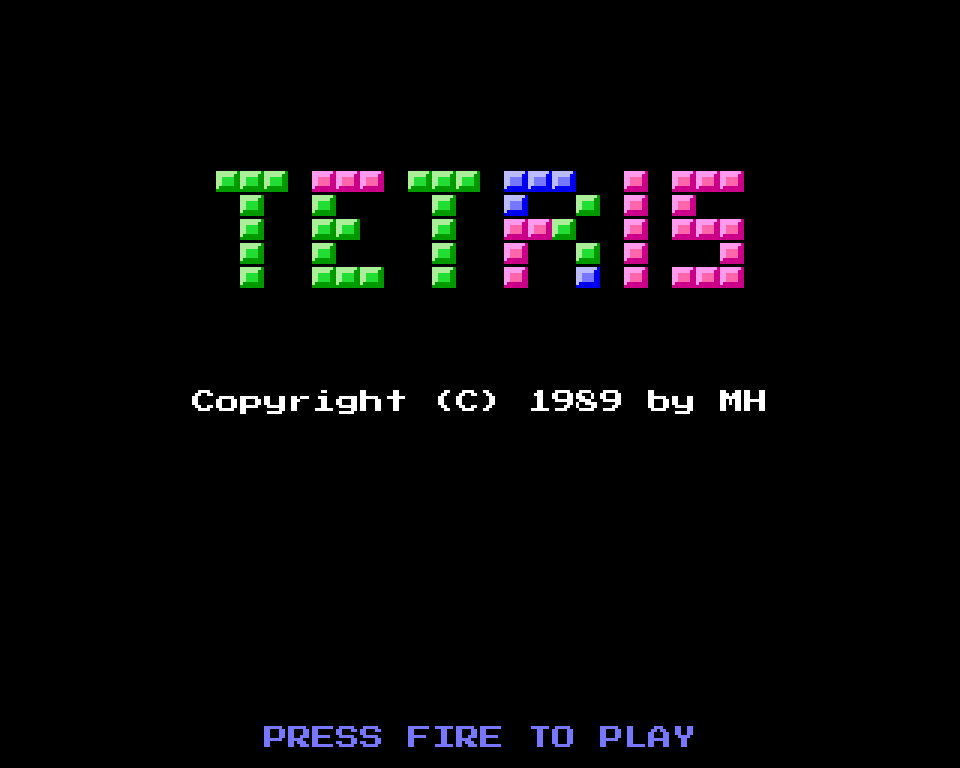
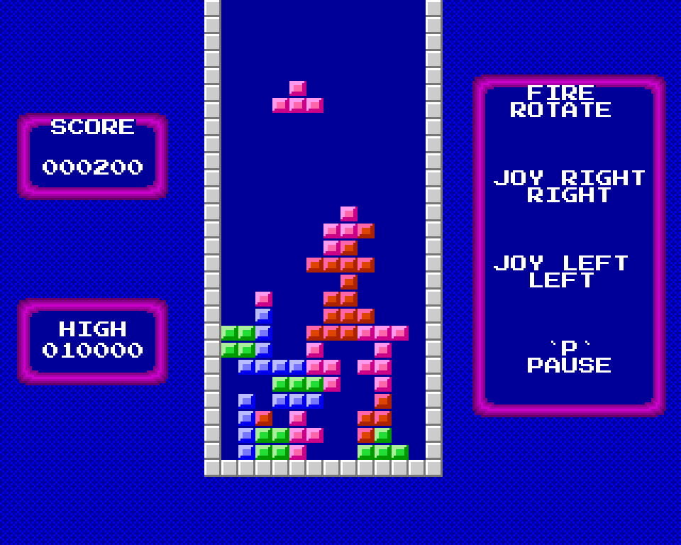

# AMIGA TETRIS
written in October 1989 by Mike Hesser in GFA-BASIC for the Commodore Amiga

**Play it online: https://mikehesser.github.io/Amiga-Tetris/**

A Tetris clone with smoothly falling pieces: they move down pixel by pixel instead of jumping from row to row.
To make this fast enough, the blocks are drawn by a small 68000 machine code routine that is embedded in the
BASIC program (`INLINE`). It writes the 8×8 blocks directly into the bitplanes and waits for the raster beam.
The top row of every block is empty, so a block falling down one pixel erases its own old edge.

Besides the seven classic pieces there are some extra ones: a single block, a three-block bar and a "^" made of three blocks that only touch at their corners. A cross is defined too, but it never appears: when it is chosen, the program immediately picks another piece.

The intro lets pieces fall down to form the word "TETRIS". When you press fire, the screen "melts":
random rows and columns are shifted pixel by pixel.

## How to play

Open the link above, or download the repository and open `index.html` in a web browser. No installation required.

| Key | Function |
| --- | --- |
| `←` `→` | Move (joystick left / right) |
| `Space` or `↑` | Rotate (fire button) |
| `P` | Pause |

On touch devices tap the left, right or middle part of the screen.

At the start you choose the speed from 1 to 10, where 1 is the fastest. Pieces can only be moved and rotated
when they are exactly on a row. Every piece gives 10 points, every complete row 100 points.
The best ten scores are kept in a top ten list.

## About this version

The original program only existed as a tokenized `.GFA` file. To read it, I wrote a small converter
(`tools/gfa2lst.py`). It figures out the token format by comparing other GFA programs with their ASCII exports.
The browser version follows the decoded listing procedure by procedure. It emulates the Amiga screen
(320×256 pixels, 32 colors) and uses the block graphics taken from the embedded machine code.

Differences compared to the original:

* Keyboard and touch controls instead of a joystick.
* The high scores are stored in the browser instead of the file `TetrisH.dat`.
* The speed of the falling pieces and of the effects is an estimate of the timing on the Amiga.
* The background pattern (`DEFFILL 3,2,23`) is a reconstruction.
* The Amiga Topaz font is replaced by the similar pixel font "Press Start 2P" (loaded from Google Fonts).

## Files

| File | Description |
| --- | --- |
| `index.html` | The browser version (HTML/JavaScript, a single file) |
| `original/TETRIS.GFA` | Original GFA-BASIC program (tokenized) |
| `original/TETRIS.LST` | Decoded source code as plain text |
| `original/TETRIS_INLINE.bin` | The embedded 68000 machine code routine with the block graphics |
| `tools/gfa2lst.py` | Converter from tokenized GFA-BASIC (Amiga) files to text |
