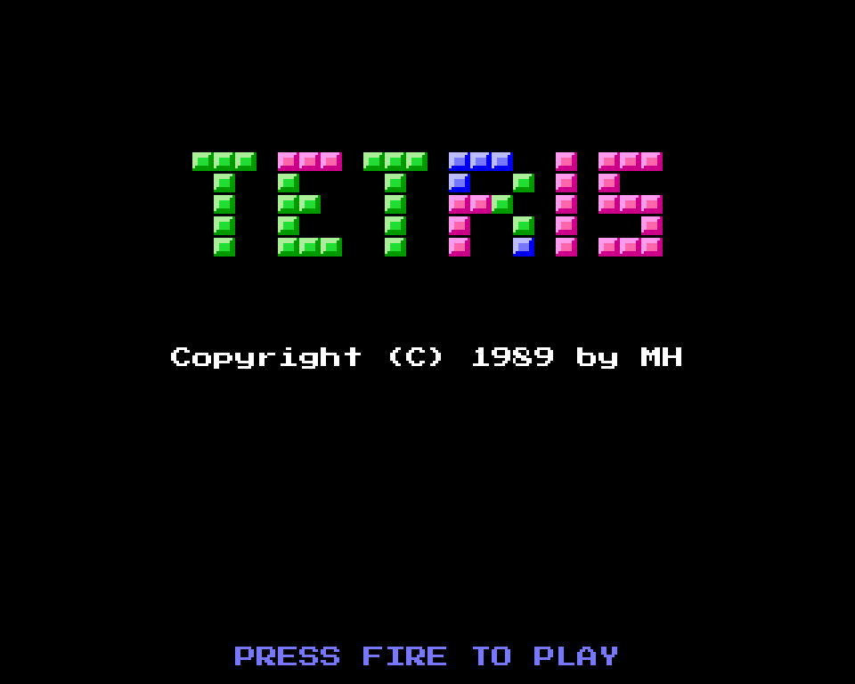
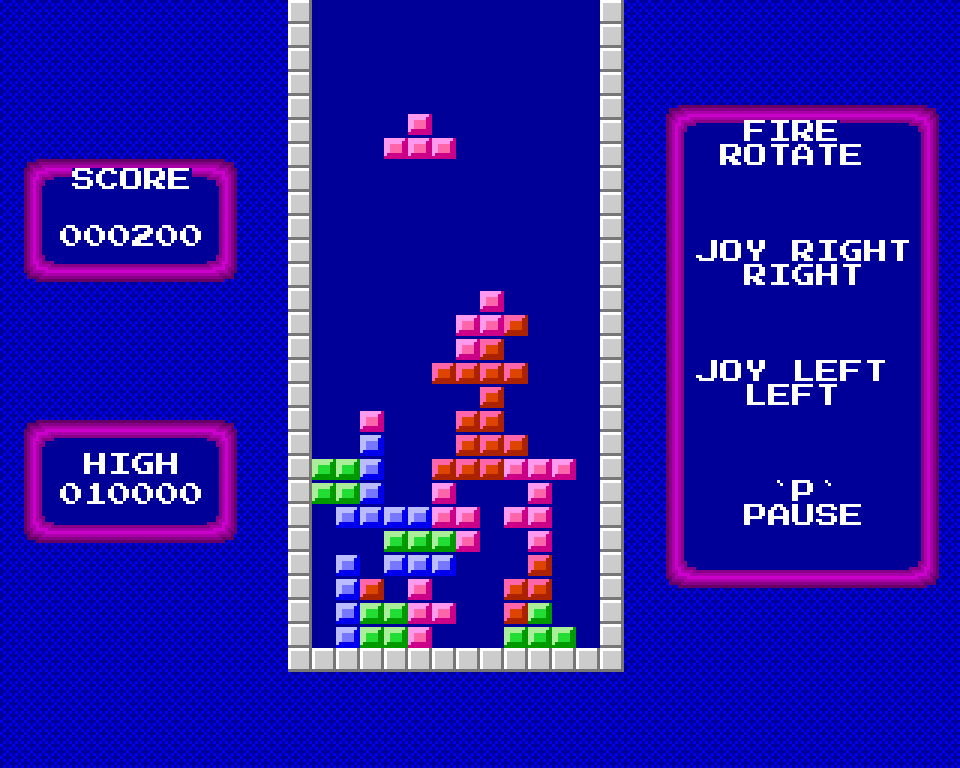

# AMIGA TETRIS
geschrieben im Oktober 1989 von Mike Hesser in GFA-BASIC für den Commodore Amiga

**Online spielen: https://mikehesser.github.io/Amiga-Tetris/**

Ein Tetris-Klon mit fließend fallenden Teilen: Sie bewegen sich pixelweise nach unten statt von Zeile zu Zeile zu springen.
Damit das schnell genug geht, werden die Blöcke von einer kleinen 68000-Maschinenroutine gezeichnet, die im
BASIC-Programm steckt (`INLINE`). Sie schreibt die 8×8-Blöcke direkt in die Bitplanes und wartet auf den Rasterstrahl.
Die oberste Zeile jedes Blocks ist leer, so löscht ein Block beim Fallen um ein Pixel seine eigene alte Kante.

Neben den sieben klassischen Teilen gibt es ein paar zusätzliche: einen Einzelblock, einen Dreierstab und ein „^“ aus drei Blöcken, die sich nur an den Ecken berühren. Ein Kreuz ist auch definiert, erscheint aber nie: Wird es ausgelost, wählt das Programm sofort ein anderes Teil.

Im Vorspann fallen Teile herab und bilden den Schriftzug „TETRIS“. Bis man Feuer drückt, „schmilzt“ der Bildschirm:
zufällige Zeilen und Spalten werden pixelweise verschoben.

## Spielen

Den Link oben öffnen, oder das Repository herunterladen und `index.html` im Webbrowser öffnen. Keine Installation nötig.

| Taste | Funktion |
| --- | --- |
| `←` `→` | Bewegen (Joystick links / rechts) |
| `Leertaste` oder `↑` | Drehen (Feuerknopf) |
| `P` | Pause |

Auf Touch-Geräten links, rechts oder in die Mitte des Bildes tippen.

Zu Beginn wählt man die Geschwindigkeit von 1 bis 10, dabei ist 1 am schnellsten. Bewegen und Drehen geht nur,
wenn ein Teil genau auf einer Zeile steht. Jedes Teil bringt 10 Punkte, jede volle Reihe 100 Punkte.
Die zehn besten Ergebnisse kommen in eine Bestenliste.

## Zu dieser Version

Das Originalprogramm gab es nur als tokenisierte `.GFA`-Datei. Um es lesen zu können, habe ich einen kleinen
Konverter geschrieben (`tools/gfa2lst.py`). Er ermittelt das Tokenformat durch den Vergleich anderer GFA-Programme
mit ihren ASCII-Fassungen. Die Browser-Version folgt dem entschlüsselten Listing Prozedur für Prozedur. Sie bildet
den Amiga-Bildschirm nach (320×256 Pixel, 32 Farben) und verwendet die Blockgrafik aus der eingebetteten Maschinenroutine.

Unterschiede zum Original:

* Steuerung mit Tastatur und Touch statt Joystick.
* Die Bestenliste wird im Browser gespeichert statt in der Datei `TetrisH.dat`.
* Das Tempo der fallenden Teile und der Effekte ist dem Amiga-Timing nachempfunden.
* Das Hintergrundmuster (`DEFFILL 3,2,23`) ist nachgebildet.
* Der Amiga-Font Topaz wird durch den ähnlichen Pixelfont „Press Start 2P“ (von Google Fonts) ersetzt.

## Dateien

| Datei | Beschreibung |
| --- | --- |
| `index.html` | Die Browser-Version (HTML/JavaScript, eine einzige Datei) |
| `original/TETRIS.GFA` | Originales GFA-BASIC-Programm (tokenisiert) |
| `original/TETRIS.LST` | Entschlüsselter Quelltext als Text |
| `original/TETRIS_INLINE.bin` | Die eingebettete 68000-Maschinenroutine mit der Blockgrafik |
| `tools/gfa2lst.py` | Konverter von tokenisierten GFA-BASIC-Dateien (Amiga) in Text |
